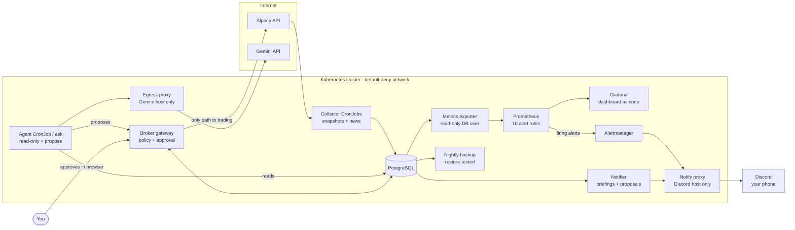

# Portfolio Agent

An AI agent that watches an Alpaca **paper-trading** portfolio, answers questions about it, writes a daily briefing, and can *propose* trades. It can never place one. Every trade needs a human click, passes a code-enforced policy twice, and the agent runs in a network that can reach exactly one host on the internet.

It runs on Docker, Kubernetes (kind) and Terraform, and costs nothing to run. Paper money only.

> The interesting part is not that an LLM can call tools. It is what surrounds it: a gateway the model cannot bypass, a network it cannot escape, and measurements that tell you when it is wrong.

---

## Architecture



| Piece | What it does |
|---|---|
| **Collectors** | Every 5 minutes in market hours, store account and position snapshots; hourly, store news. |
| **Agent** | Gemini with function calling. Tools are read-only except `propose_trade`. Capped at 8 model calls per run and 2 proposals per conversation. Every step is written to an audit table. |
| **Broker gateway** | The only component holding trading credentials. Takes proposals, runs the policy, waits for a human to approve, then submits the order. |
| **Egress proxy** | The agent's only route to the internet. Allows `CONNECT` to the Gemini host and nothing else. Private IP ranges are refused. |
| **Notifications** | Alerts (through Alertmanager), each daily briefing, and each trade proposal waiting for approval arrive in a Discord channel. They leave through a second allowlisting proxy that reaches `discord.com` only, and the agent has no route to it. |
| **Backups** | A nightly `pg_dump`, restored into a scratch database and checked before it is kept. The newest 7 verified backups are retained. |
| **Monitoring** | A custom exporter reads Postgres (read-only) and Prometheus alerts on it. The Grafana dashboard is generated from Python and provisioned by Terraform. |

---

## What makes it safe

**1. The model proposes; code decides.** The agent holds a token that can only create proposals. A separate approver token, which the agent never sees, can approve them. The policy engine is plain code with no LLM in the loop.

**2. The policy runs twice.** Once when a proposal is created and again at approval, with fresh account state. A proposal that was fine two hours ago can fail now.

| Rule | Default limit |
|---|---|
| Single trade size | $5 to $2,000 |
| Daily dollars traded | $5,000 |
| Trades per day | 5 |
| One holding's share of portfolio | 25% |
| Cash floor after a buy | 5% |
| Pending proposals at once | 3 |
| Proposal lifetime | 120 minutes |
| Rationale | at least 30 characters |

**3. Approval is atomic and idempotent.** A proposal is claimed with `UPDATE ... WHERE status = 'pending'`, so two clicks cannot both win. Each order carries a `client_order_id`, so a retry after a crash cannot double-submit. Partial fills are tracked. A kill switch halts all trading.

**4. News is treated as hostile.** Headlines are untrusted input and are labelled that way in the prompt, with a provenance flag on the data. A red-team suite fires 10 prompt-injection attacks plus 2 control cases. The latest run resisted all 10.

**5. The network is the last line of defence.** Even a fully compromised agent cannot reach the broker or the open internet: 14 NetworkPolicies enforce default-deny with explicit allowlists. `netcheck` starts a pod in the agent's exact network position and tries 12 connections for real, including the notification path the agent must not be able to use; it fails loudly if any rule is not actually enforced. Some network plugins (k3s's included) apply a new pod's rules a few seconds after it starts; netcheck caught an agent pod reaching the internet in that window on the AWS server. So every pod now starts behind `netgate`, an init container that waits until a forbidden connection is actually refused and its required ones accepted, and fails closed if that never happens. Pods run non-root with a read-only root filesystem, dropped capabilities, and no service-account token.

---

## How I know it is correct

The agent is not trusted to do arithmetic, or even to type a number. **Tools do the math, the code writes every figure, and the model only explains.** Each number in a tool result carries a handle like `[F7]`; the model writes the handle and the code substitutes the exact value, recording which field it came from. Then every answer is checked, and a number that isn't in the data gets one repair attempt before it is reported.

- **Evaluation suite:** 14 questions with known answers. Latest run: 14 of 14 correct, 100% of cited numbers grounded.
- **Grounding check:** every number in an answer must appear in the data the agent actually retrieved, matched by type (dollars, percent, plain number).
- **Live grounding:** the same check runs on real answers in production, and the result is on the dashboard and has an alert.

**The bug that made this necessary.** An early daily briefing said a position was 62.67% of the portfolio when the real figure was 60.67%, and labelled "47%" as the top three holdings when it was something else. Nothing crashed; the answer just looked right. That is why arithmetic moved into tools, the prompt forbids the model from computing, and grounding is checked automatically. The live-grounding tile on the dashboard still shows those old briefings aging out of its 7-day window while the 24-hour line sits at zero.

---

## Monitoring

Grafana shows 22 panels in four groups: health, portfolio, agent behaviour, and accuracy and safety. Twelve Prometheus alert rules cover stale portfolio data, stale market prices and news, failing runs, model errors, ungrounded answers, a failing evaluation, a red-team regression, the kill switch being on, and proposals waiting for a decision. Alertmanager groups them, sends each one once to Discord, and says when it clears.

The dashboard is a Python file. Terraform deploys the generated JSON and Grafana's provisioning forbids editing it in the UI, so what runs is what was reviewed. CI fails if the JSON is out of date.

**Engineering note.** Grafana first failed to become ready on an 8 GB laptop: a 1-second health check, a 384 MB limit, and SQLite lock contention. The logs showed 5,503 failed probes. The fix was a 768 MB limit, a 5-second probe, an in-memory state volume, and disabling Grafana's own alerting, since Prometheus already evaluates the rules. The whole monitoring stack costs about 0.6 GiB.

---

## Infrastructure

| | |
|---|---|
| **Docker** | One slim Python 3.12 image, non-root user, built and scanned with Trivy in CI. |
| **Kubernetes** | CronJobs (New York time zone), Deployments, a Postgres StatefulSet, 14 NetworkPolicies, resource limits, health probes. |
| **Terraform** | Layer 1 builds a cluster: `cluster` makes a kind cluster on the laptop, `aws` makes the cloud one. Layer 2, `platform`, deploys everything onto either, unchanged, generating random passwords and reading API keys from `.env`. |
| **AWS** | One ARM server (t4g.small) running k3s, inside the free plan's credits (about $18 a month, with a budget alarm). No inbound ports at all: you reach it through an AWS Systems Manager tunnel. Pods can't reach the server's AWS role (IMDSv2, hop limit 1). Disk and Kubernetes secrets are encrypted. Nightly restore-tested backups are copied to a private S3 bucket. |
| **Images** | CI builds every passing commit for Intel and ARM, with an SBOM and provenance, and publishes it to GitHub's container registry tagged with the commit. The cloud deploys exactly that tag. |
| **CI** | GitHub Actions with actions pinned to commit SHAs: Ruff, 172 tests against a real Postgres (including the agent loop driven by a scripted stand-in model), `terraform fmt` and `validate`, kubeconform on every manifest, image build and Trivy scan. |

---

## Run it

Needs Docker Desktop, `kind`, `kubectl`, Terraform, Python 3.12, and free Alpaca (paper) and Gemini API keys.

```powershell
# create .env (git-ignored) with ALPACA_API_KEY, ALPACA_SECRET_KEY, GEMINI_API_KEY, GEMINI_MODEL
# optional: DISCORD_WEBHOOK_URL=https://discord.com/api/webhooks/...  (alerts and briefings on your phone)
docker build -t portfolio-agent:v10 .
.\scripts\up.ps1                # cluster, then platform

.\scripts\ask.ps1 "What is my biggest position?"
.\scripts\gateway.ps1           # approval page for trade proposals
.\scripts\grafana.ps1           # dashboard at http://127.0.0.1:3000

.\scripts\redteam.ps1           # 10 attacks, plus controls
.\scripts\netcheck.ps1          # prove the network lockdown
.\scripts\evaluate.ps1          # 14-question accuracy suite
.\scripts\backup.ps1            # back up the database now (restore-tested)
.\scripts\notify-test.ps1       # send a test alert to Discord
.\scripts\down.ps1
```

On AWS (the AWS CLI and Session Manager plugin installed, signed in, and your email in `terraform\aws\terraform.tfvars`):

```powershell
.\scripts\cloud-up.ps1           # build the server, deploy the image CI published for this commit
.\scripts\migrate-to-cloud.ps1   # once: move the laptop's database to the cloud
.\scripts\cloud-tunnel.ps1       # the only way in; every other script then works against the cloud
.\scripts\grafana.ps1 -Cloud     # Grafana runs on demand on the 2 GB server
.\scripts\cloud-down.ps1         # download every backup, then delete everything on AWS
```

Tests: `python -m pytest`. Database tests run when `TEST_DATABASE_URL` points at a throwaway Postgres; they empty the tables, so never point it at real data.

---

## Layout

```
agent.py  tools.py  grounding.py  evaluate.py  redteam.py   the agent and how it is measured
policy.py  broker.py  gateway.py  web/                       the trade gateway
egress_proxy.py  netcheck.py                                 network isolation
collector.py  schema.py  metrics_exporter.py  notifier.py    data, metrics, notifications
k8s/        manifests (workloads, network policies, monitoring, notifications, backup)
terraform/  cluster/ and platform/ layers
monitoring/ dashboard as code
scripts/    PowerShell helpers
tests/      policy, gateway, egress proxy, grounding, metrics, agent loop, notifier
```

## Honest limits

Paper trading only, and the agent is not a trading strategy. Single node, no high availability: one server, laptop or cloud. The AWS free plan ends after six months; after that it is a paid account (about $18 a month) or a move, which `cloud-down.ps1` makes easy by downloading every backup first. The LLM can still be wrong; the design assumes that and checks for it instead of hoping.
