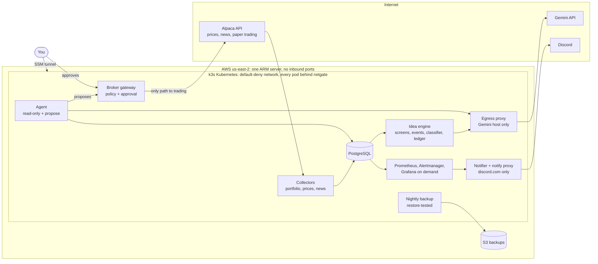

# Portfolio Agent

[](https://github.com/brithvik/portfolio_agent/actions/workflows/ci.yml)

An AI agent that watches an Alpaca **paper-trading** portfolio, answers questions about it, writes a daily briefing, and can *propose* trades. It can never place one: every trade needs a human click and passes a code-enforced policy twice. Alongside it, an **idea engine** screens about 2,700 US stocks every evening, reads the news behind the movers, and records its picks in a ledger that scores them against random stocks chosen the same day.

It runs on AWS (an ARM server running Kubernetes, built by Terraform) inside the free plan's credits. Paper money only.

> The interesting part is not that an LLM can call tools. It is what surrounds it: a gateway the model cannot bypass, a network it cannot escape, and measurements that tell you when it is wrong.

---

## Architecture



| Piece | What it does |
|---|---|
| **Collectors** | Portfolio snapshots every 5 minutes in market hours; news hourly; at 6:30 PM, daily prices for every US stock above a liquidity floor. |
| **Agent** | Gemini with function calling. Tools are read-only except `propose_trade`. At most 8 model calls per run and 2 proposals per conversation. Every step goes to an audit table. |
| **Broker gateway** | The only component holding trading credentials. Takes proposals, runs the policy, waits for a human, then submits the order. |
| **Egress proxy** | The agent's only route out. Allows `CONNECT` to the Gemini host and nothing else; private ranges are refused. |
| **Idea engine** | Screens, news events, a classifier, rule-based flags and a ledger with matched controls (below). |
| **Notifications** | Alerts, the daily briefing, trade proposals and the daily idea digest arrive in Discord, through a second proxy that reaches `discord.com` only. The agent has no route to it. |
| **Backups** | A nightly `pg_dump`, restored into a scratch database and checked before it is kept, then copied to a private S3 bucket. |
| **Monitoring** | A custom exporter reads Postgres read-only; Prometheus evaluates 12 alert rules; the Grafana dashboard is generated from Python. |

---

## What makes it safe

**1. The model proposes; code decides.** The agent holds a token that can only create proposals. A separate approver token, which the agent never sees, approves them. The policy engine is plain code with no LLM in the loop, and it runs twice: at proposal and again at approval, with fresh account state.

| Rule | Default limit |
|---|---|
| Single trade size | $5 to $2,000 |
| Daily dollars traded | $5,000 |
| Trades per day | 5 |
| One holding's share of portfolio | 25% |
| Cash floor after a buy | 5% |
| Pending proposals / lifetime | 3 / 120 minutes |

**2. Approval is atomic and idempotent.** A proposal is claimed with `UPDATE ... WHERE status = 'pending'`, so two clicks cannot both win. Each order carries a `client_order_id`, so a retry after a crash cannot double-submit. A kill switch halts all trading.

**3. News is treated as hostile.** Headlines are untrusted input, labelled that way in every prompt. A red-team suite fires 10 prompt-injection attacks plus 2 controls; the latest run resisted all 10. The classifier can only answer from fixed lists, and code discards anything else.

**4. The network is the last line of defence.** 14 NetworkPolicies enforce default-deny with explicit allowlists. `netcheck` starts a pod in the agent's exact network position and tries 12 real connections. In the cloud it passes 12 of 12.

**5. Nothing is exposed.** The AWS server has no inbound firewall rules at all; you reach it through an AWS Systems Manager tunnel that needs your AWS login. Pods cannot reach the server's AWS role (IMDSv2, hop limit 1). Pods run non-root with read-only filesystems, dropped capabilities and no service-account token.

---

## How I know it is correct

**The agent never types a number.** Tools do the math; each figure in a tool result carries a handle like `[F7]`; the model writes the handle and code substitutes the exact value, recording which field it came from. Any number that still isn't in the data gets one repair attempt, then is reported.

- **Evaluation:** 14 questions with known answers. Latest run: 14 of 14, 100% of cited numbers grounded.
- **Live grounding:** the same check runs on every real answer, with a dashboard panel and an alert.
- **Self-check:** each evening the screens recompute their top results a second way, in SQL, and stop if the two disagree. Six figures were also recomputed by hand from stored prices and matched to the decimal.

**The bug that started it.** An early briefing said a position was 62.67% of the portfolio when it was 60.67%. Nothing crashed; it just looked right. That is why the model no longer writes figures at all.

---

## The idea engine: an experiment, not a stock picker

Every weekday evening:

1. **Universe.** Every tradable US stock priced at $5 or more with at least $5M traded a day: about 2,700 of 5,700. Recorded daily, never rewritten, so stocks that drop out stay in the history.
2. **Screens.** Return against the S&P 500 over 3 and 6 months, how many of the last 8 weeks it beat the market, volume growth, distance from its high. About 7% of stocks qualify as "rising." Thresholds live in a versioned rules file, fixed before any results existed.
3. **Events.** News is grouped into events, so twenty rewrites of one press release count once.
4. **Classifier.** Gemini labels each event's type and direction. Broker notes and call transcripts are labelled by pattern without the model. Measured on hand-labelled headlines: 98% type, 91% direction on the first 47.
5. **Rules.** Code turns labels into flags. A company being acquired is set aside ("the price is tied to the offer"); recent insider selling and strong, weak or mixed results are flagged.
6. **Ledger.** Every candidate is recorded once, with what was known at the time, plus three random stocks from the same day and tier as controls. A candidate whose recent news isn't fully labelled yet is held back rather than recorded on partial evidence.

**How it is judged.** Ideas are priced from the next market open after they were recorded. The one question fixed in advance: do shortlist ideas beat their own controls over 20 trading days? The scoreboard refuses to report a difference until there are at least 30 pairs over 5 different days, and says that about 400 are needed to detect a 1% edge.

**First result (5 days, one batch):** shortlist +0.73% against the S&P 500, controls −0.66%. One week of one batch is a pipeline check, not evidence. The 20-day results arrive in mid-December.

---

## Engineering notes

Problems found by the system's own checks, and how they were fixed.

- **A network race in the cloud.** On the first cloud run, `netcheck` failed: a brand-new agent pod could reach the open internet. k3s applies a pod's NetworkPolicies a few seconds after the pod starts; the laptop's cluster never showed it. A 30-second delay passed 12 of 12, confirming the cause. The fix is `netgate`: every pod running app code starts with an init container that waits until a forbidden connection is refused and its required ones accepted, and fails closed after 60 seconds. Netcheck now passes with no delay; the gate reports the rules in force after about 2 seconds.
- **Backups failed in the cloud** for the same reason (the stock Postgres image has no gate). The backup now waits for the database before starting.
- **False takeovers.** The takeover rule set aside a company selling one of its units ("Naviam to acquire Cohesive from Bentley Systems") and a partial tender offer. Version 2 of the flag rules counts a takeover only when the model labels it positive and the offer is for the whole company, and each idea records which flag version judged it.
- **The model leaned positive** on headlines that state no outcome ("X Reports Third-Quarter Results"). Those are now labelled "unclear" by pattern.
- **Grafana on an 8 GB laptop** failed its health check 5,503 times: a 1-second probe, a 384 MB limit and SQLite lock contention. Fixed with a longer probe, more memory and in-memory state. In the cloud it runs only on demand.

---

## Infrastructure

| | |
|---|---|
| **AWS** | One t4g.small (2 ARM cores, 2 GB) in us-east-2, built by Terraform: network, firewall, IAM role, encrypted disk, S3 bucket, budget alarm. About $18 a month, paid from free-plan credits. |
| **Kubernetes** | k3s in the cloud, kind on the laptop. CronJobs on New York time, Deployments, a Postgres StatefulSet, 14 NetworkPolicies, resource limits, health probes. |
| **Terraform** | Layer 1 builds the cluster (`aws` or `cluster` for kind). Layer 2, `platform`, deploys onto either unchanged, generating passwords and reading keys from `.env`. |
| **Images** | CI builds every passing commit on native Intel and ARM runners, with an SBOM and provenance, and publishes one multi-platform tag per commit to GitHub's container registry. The cloud deploys exactly that tag. |
| **CI** | Actions pinned to commit SHAs. Ruff, 183 tests against a real Postgres (including the agent loop with a scripted stand-in model), `terraform validate` on both clusters, kubeconform, a Trivy scan. |

---

## Run it

Needs Docker Desktop, `kubectl`, Terraform, Python 3.12, and free Alpaca (paper) and Gemini API keys. Create `.env` (git-ignored) with `ALPACA_API_KEY`, `ALPACA_SECRET_KEY`, `GEMINI_API_KEY`, `GEMINI_MODEL`, and optionally `DISCORD_WEBHOOK_URL`.

**On AWS** (AWS CLI and Session Manager plugin, `aws login`, your email in `terraform\aws\terraform.tfvars`):

```powershell
.\scripts\cloud-up.ps1           # build the server, deploy the image CI published for this commit
.\scripts\cloud-tunnel.ps1       # the only way in; every other script then works against the cloud
.\scripts\cloud-down.ps1         # download every backup, then delete everything on AWS
```

**On a laptop** (also needs `kind`): `docker build -t portfolio-agent:v21 .` then `.\scripts\up.ps1`.

**Either way:**

```powershell
.\scripts\ask.ps1 "What is my biggest position?"
.\scripts\gateway.ps1            # approval page for trade proposals
.\scripts\netcheck.ps1           # prove the network lockdown
.\scripts\redteam.ps1            # 10 prompt-injection attacks, plus controls
.\scripts\evaluate.ps1           # 14-question accuracy suite
.\scripts\ledger.ps1 report      # the idea engine's scoreboard
.\scripts\grafana.ps1 [-Cloud]   # the dashboard
.\scripts\backup.ps1             # back up now (restore-tested)
```

Tests: `python -m pytest`. Database tests run when `TEST_DATABASE_URL` points at a throwaway Postgres; they empty the tables.

---

## Layout

```
agent.py  tools.py  citations.py  grounding.py  evaluate.py  redteam.py   the agent and how it is measured
policy.py  broker.py  gateway.py  web/                                    the trade gateway
market.py  screens.py  events.py  classify.py  ledger.py  rules/  evals/  the idea engine
egress_proxy.py  netcheck.py  netgate.py                                  network isolation
collector.py  schema.py  metrics_exporter.py  notifier.py                 data, metrics, notifications
k8s/  terraform/{aws,cluster,platform}/  monitoring/  scripts/  tests/
```

## Honest limits

Paper trading only, and neither the agent nor the idea engine is a trading strategy; the ledger exists to find out whether the ideas are worth anything, and a "no edge" result is a valid outcome. One server, no high availability. The AWS free plan ends after six months; `cloud-down.ps1` downloads every backup before deleting anything. The news feed comes from one provider, so "independent sources" cannot really be counted. The LLM can still be wrong; the design assumes that and checks for it instead of hoping.
